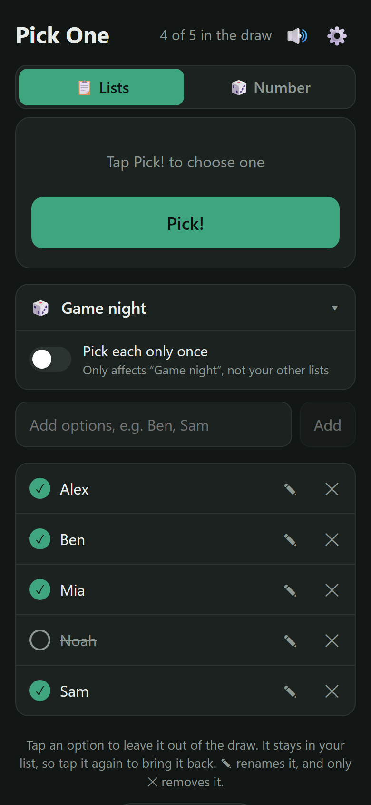
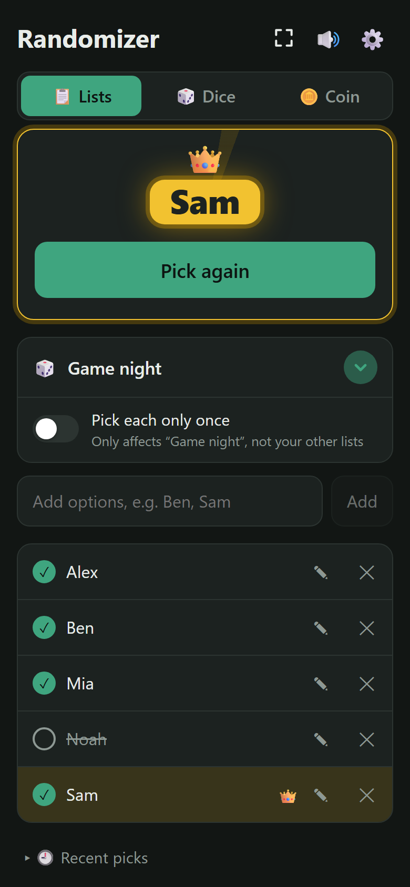
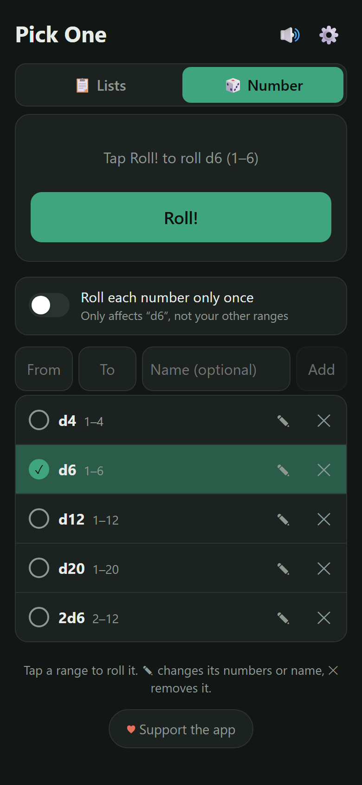

# 👑 Pick One

A tiny web app that picks one thing at random from a list, with a slot-machine spin, confetti and sound effects.

**Try it:** https://neckfors.github.io/pick-one/

It installs on your phone like a normal app, works offline, and remembers your lists.

  
  
  

## What can it be used for?

Anything where you need a fair, random pick:

- 🎮 **Who starts the game:** board games, card games, video games
- 🍕 **Where to eat:** put your usual restaurants on the list and stop arguing
- 🎬 **What to watch:** movies, series or that ever-growing "watch later" list
- 🧹 **Who does the chore:** dishes, taking out the trash, walking the dog
- 🚗 **Who drives** or who picks the music in the car
- 🏫 **Who answers next:** pick a student, or who presents first in a meeting
- 🎁 **Giveaways and raffles:** pick from the participants
- 🍳 **What's for dinner:** add the meals you know how to cook
- 📚 **What to read or play next** from your backlog
- 🏃 **Which workout today:** run, gym, yoga, rest day…
- 🤔 **Any tough decision:** when you just can't choose, let it choose
- 🔢 **A random number:** roll a die, pick a raffle ticket, or any number between two values

## How it works

1. **Choose a list:** tap the list button under the Pick! area to see all your lists (*🎲 Game night*, *🍳 Who makes dinner*, *🍕 Where to eat*, …) and tap one to switch. Each list keeps its own options, so the names in one list never show up in another.
2. **Add options** using the field under the list (the **Add** button lights up once you type something). Add several at once by separating them with commas (`Ben, Sam`), or paste a list with one option per line.
3. **Tap an option** to leave it out for now (someone isn't here, the restaurant is closed…). Tap it again to bring it back.
4. **Tap Pick!** and watch it spin. The picked option lights up in gold, with a 👑 and confetti.
5. **Rename an option** with its **✎**: the row turns into a field with a **✓**. Type the new name and tap ✓ or press Enter (Esc cancels). Tapping somewhere else saves too.
6. Remove an option for good with **✕**. A bar with **Undo** shows for a few seconds in case it was a mistake.

Every pick is completely random. Each option in the draw has the same chance every time, even if it was picked last time.

**Pick each only once:** switch this on for a list when you want to go round instead, like taking turns on chores. Whatever gets picked sits out automatically, and when everything has been picked, the button turns into **↺ Start over** to put everything back. The setting is saved per list, so *Game night* can allow repeats while *Who makes dinner* takes turns.

**Recent picks:** under the options, *🕘 Recent picks* keeps the last 100 picks for each list, handy for "who did the dishes last time?". It shows the newest 10; tap *Show all* to see the rest.

## Rolling a number 🎲

Switch to **🎲 Number** at the top to roll a random number instead of picking from a list. It works just like a list, except each row is a range of numbers:

1. **Add a range** with the **From**, **To** and **Name (optional)** fields and **Add**. The Add button stays greyed out until From and To are whole numbers. Any whole numbers work, even 1 to 1,000,000. You start with the dice *d4* (1–4), *d6* (1–6), *d12* (1–12), *d20* (1–20) and *2d6* (2–12, two dice added up), which you can rename, change or remove.
2. **Tap a range** to choose it. It gets a ✓.
3. **Tap Roll!** (or shake your phone). A die tumbles while numbers race past, and it lands on a number from the range, both ends included.
4. **Change a range** with its **✎**: the row turns into From, To and Name fields with a **✓**. Change what you like and tap ✓ or press Enter (Esc cancels). Numbers are put in order if you swap them, and a range you already have is not added twice. **✕** removes a range.

**Roll each number only once:** switch this on for a range when the same number must not come up twice, like drawing raffle tickets. Numbers already rolled sit out, the top shows how many are left, and when every number has been rolled the button turns into **↺ Start over**. The setting is saved per range.

Removing a range shows an **Undo** bar, just like options. Your ranges are remembered and included in backups. `https://neckfors.github.io/pick-one/#number` opens straight in Number mode.

## Managing lists

In the list panel:

- **+ New list** makes a new list.
- **✎** renames a list, gives it an icon (pick one, or type any emoji from your keyboard), shares it or deletes it.
- **Drag ⠿** to put your lists in the order you like.
- **Select** lets you tick one or more lists and delete them all at once (it asks first, and always keeps at least one list).

### Each list's own address

Every list has its own address, for example `https://neckfors.github.io/pick-one/#game-night`. Opening it starts Pick One straight on that list, and the address bar follows whichever list you're on. Copy it with ✎ → **🔗 Copy this list's address**, and bookmark it if you like. The address only opens *your* copy of the list on that device. To give a list to someone else, use **Share** below. If you rename a list, it gets a new address, and the old one keeps working.

### Sharing a list

Tap ✎ on a list, then **⤴ Share this list**. You get a link to send to anyone. When they open it, Pick One asks whether to add the list, with all its options, to their own lists. The list travels inside the link itself, so nothing is uploaded anywhere.

## Settings ⚙️

- **Shake to pick** (on by default on phones): give your phone two quick shakes instead of tapping Pick! The hint in the Pick! card then reads *Tap Pick! or shake your phone*. On iPhone, a *📳 Tap to turn on shake to pick* button shows first, because Safari asks for motion access once. Tap *No thanks* next to it if you don't want shaking. You can switch it on or off here any time.
- **Sound effects:** on or off (the 🔊 button at the top does the same).
- **Spin time:** how long a pick or roll spins before it lands, from *Instant* to 3 seconds (the default).
- **Backup:** *Save backup* downloads a file with all your lists. *Restore* loads such a file and replaces your lists with it. Use it to keep your lists safe, or to move them to a new phone.

## Install on your phone

- **iPhone:** open the link in Safari, tap **Share**, then **Add to Home Screen**.
- **Android:** open the link in Chrome and tap **Install app** (also in the ⋮ menu).

> On iPhone, the silent switch also mutes the sound effects.

**Updates:** the app checks for a new version whenever you open it or come back to it. When one has downloaded, a bar with **✨ New version available · Update** appears at the top; tap **Update** to switch to it. Your lists and ranges are kept.

## Tech

Plain HTML, CSS and JavaScript, with no build step or dependencies.

| File | Purpose |
|---|---|
| `index.html` | The whole app: layout, styles and logic |
| `manifest.json` | App name, icons and colors, so it can be installed |
| `sw.js` | Service worker that caches the files for offline use |
| `icon-192.png`, `icon-512.png` | App icons |
| `screenshots/` | The pictures in this README |

- Your lists are stored in the browser's `localStorage` on your device. Nothing is sent anywhere.
- Shared lists are encoded in the link after `#list=`, which never reaches the server.
- The sounds are generated with the Web Audio API, so there are no audio files.
- The random pick uses `crypto.getRandomValues`.

### Making changes

Edit the files and push to `main`. GitHub Pages publishes automatically.
**Change `CACHE` in `sw.js` every time** (for example `whostarts-v45` → `whostarts-v46`), otherwise installed copies keep showing the old version and the update bar never appears.

## Support

If you like the app, you can support it on [PayPal](https://paypal.me/neckfors). Thank you!
