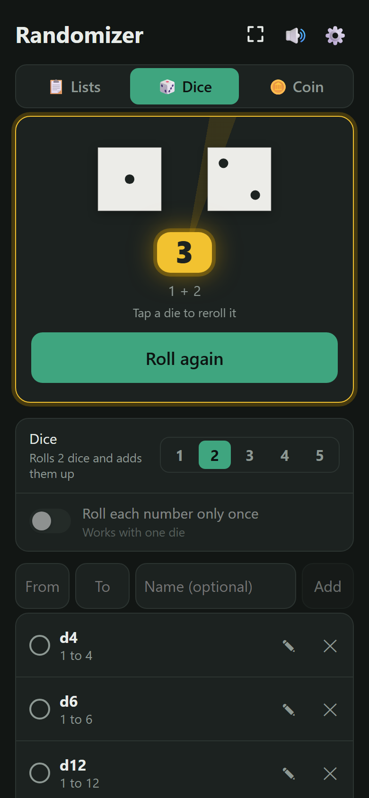
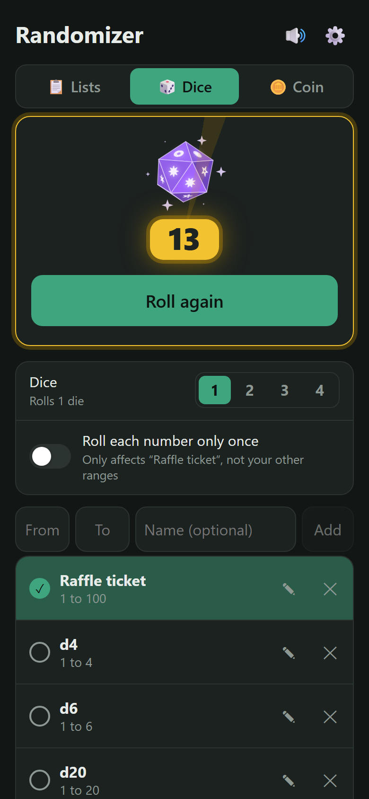
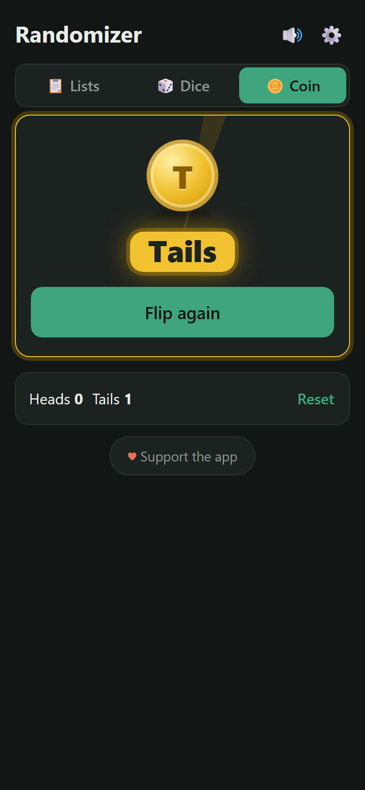
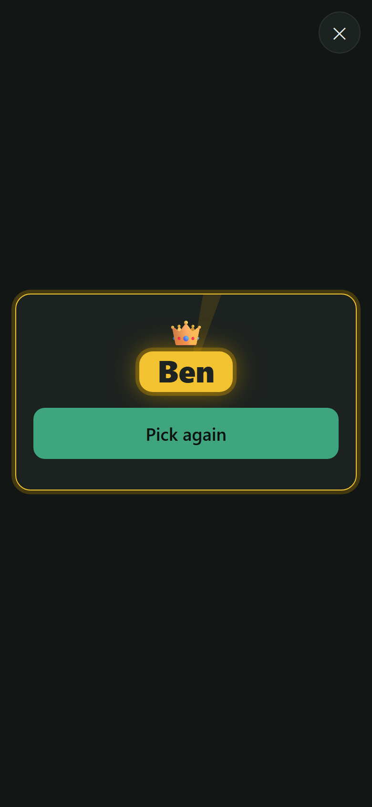

# 👑 Randomizer

A tiny web app that picks one thing at random from a list, rolls up to five 3D dice or flips a coin, with a spinning name reel, tumbling dice, confetti and sound effects.

**Try it:** https://neckfors.github.io/randomizer/

It installs on your phone like a normal app, works offline, and remembers your lists.

  
  
  
  
  
  

## What can it be used for?

Anything where you need a fair, random pick:

- 🎮 **Who starts the game:** board games, card games, video games
- 🍕 **Where to eat:** put your usual restaurants on the list and stop arguing
- 🎬 **What to watch:** movies, series or that ever-growing "watch later" list
- 🧹 **Who does the chore:** dishes, taking out the trash, walking the dog
- 🚗 **Who drives** or who picks the music in the car
- 🏫 **Who answers next:** pick a student, or who presents first in a meeting
- 🎁 **Giveaways and raffles:** pick from the participants
- 🍳 **What's for dinner:** add the meals you know how to cook
- 📚 **What to read or play next** from your backlog
- 🏃 **Which workout today:** run, gym, yoga, rest day…
- 🤔 **Any tough decision:** when you just can't choose, let it choose
- 🔢 **A random number:** roll dice for a board game, play dice games where you keep some dice and reroll the rest (Yahtzee-style), roll percentile dice for 1 to 100, pick a raffle ticket, or any number between two values
- 🪙 **Heads or tails:** flip a coin to settle it

## How it works

1. **Choose a list:** tap the list button under the Pick! area to see all your lists (*🎲 Game night*, *🍳 Who makes dinner*, *🍕 Where to eat*, …) and tap one to switch. Each list keeps its own options, so the names in one list never show up in another.
2. **Add options** using the field under the list (the **Add** button lights up once you type something). Add several at once by separating them with commas (`Sam, Ben`), or paste a list with one option per line.
3. **Tap an option** to leave it out for now (someone isn't here, the restaurant is closed…). Tap it again to bring it back.
4. **Tap Pick!** Your options spin past on a slot-machine reel, big and blurred at speed, then slow down with clicks. The name in the middle, between two gold pointers, wears the gold badge, and the names around it shrink and fade like on a turning drum. When it stops, that badge is the pick, with a 👑 and confetti. The reel works like a wheel: each spin shuffles your names into a new random order that goes round and round, so every name shows once before any comes back. Like the dice, the pick is chosen first and the wheel just turns far enough to stop on it, so the result is still completely random.
5. **Rename an option** with its **✎**: the row turns into a field with a green **Save** button. Type the new name and tap Save or press Enter (Esc cancels). Tapping somewhere else saves too.
6. Remove an option for good with **✕**: it turns into a red **Delete** button in the same spot, with **Cancel** next to it. Tap Delete to remove it, or Cancel (or anywhere else) to keep it.

Every pick is completely random. Each option in the draw has the same chance every time, even if it was picked last time.

**Pick each only once:** switch this on for a list when you want to go round instead, like taking turns on chores. Whatever gets picked sits out automatically, and when everything has been picked, the button turns into **↺ Start over** to put everything back. The setting is saved per list, so *Game night* can allow repeats while *Who makes dinner* takes turns.

**Recent picks:** under the options, *🕘 Recent picks* keeps the last 100 picks for each list, handy for "who did the dishes last time?". It shows the newest 10; tap *Show all* to see the rest.

## Rolling dice 🎲

Switch to **🎲 Dice** at the top to roll dice, or any random number, instead of picking from a list. It works just like a list, except each row is a range of numbers:

1. **Add a range** with the **From**, **To** and **Name (optional)** fields and **Add**. The Add button stays greyed out until From and To are whole numbers. Any whole numbers work, even 1 to 1,000,000. You start with the dice *d4* (1 to 4), *d6* (1 to 6), *d12* (1 to 12), *d20* (1 to 20) *2d6* (2 dice, each 1 to 6, added up) and *5 dice* (for dice games where you keep some dice and reroll the rest, like Yahtzee), which you can rename, change or remove.
2. **Tap a range** to choose it. It gets a ✓.
3. **Choose how many dice** it rolls with **Dice 1 2 3 4 5** above the ranges. With several dice, each die is rolled on its own and they're added up, just like real dice: with 2d6 a 7 comes up six times as often as a 2 or a 12. The row then reads *2 dice, each 1 to 6*, and the hint uses the range's name, like *Tap Roll! to roll “2d6”*.
4. **Tap Roll!** (or shake your phone). The dice tumble while numbers race past, slow down, and come to rest showing the face they rolled. With several dice, the total shows in the gold badge with the dice under it, like *4 + 5*. See [How the dice work](#how-the-dice-work) below.
5. **Change a range** with its **✎**: the row turns into From, To and Name fields with a green **Save** button. Change what you like and tap Save or press Enter (Esc cancels). Numbers are put in order if you swap them, and a range you already have is not added twice. **✕** removes a range (tap the red **Delete** to confirm, or **Cancel**).

**Roll each number only once:** switch this on for a range when the same number must not come up twice, like drawing raffle tickets. Numbers already rolled sit out, the switch shows how many have been rolled, and when every number has been rolled the button turns into **↺ Start over**. The setting is saved per range, and works with one die.

**Recent rolls:** under the ranges, *🕘 Recent rolls* keeps your last 100 rolls across all ranges. Each result shows in a small gold badge, with what was rolled next to it, like *2d6: 4 + 5* or *10 to 30*. It shows the newest 10; tap *Show all* to see the rest.

Your ranges are remembered and included in backups. `https://neckfors.github.io/randomizer/#dice` opens straight in Dice mode (older `#number` links still work).

### How the dice work

**Which die a range gets.** Every range is rolled with a real-looking 3D die whenever a real die can do it fairly. Otherwise it gets the magic die:

| Range | Die | Faces |
|---|---|---|
| 4 numbers | d4 | each number once |
| 1 number | d4 | the same number on every face |
| 2 numbers | d4 | each number twice |
| 6 numbers | d6 | each number once (dots for a plain 1 to 6) |
| 3 numbers | d6 | each number twice, like a real d3 |
| 8 numbers | d8 | each number once |
| 10 numbers | d10 | each number once |
| 5 numbers | d10 | each number twice |
| 12 numbers | d12 | each number once |
| 20 numbers | d20 | each number once |
| 1 to 100 or 0 to 99 (1 or 2 dice) | two d10s: tens and ones | percentile dice: 00–90 and 0–9 |
| anything else (7, 9, 15, 37, 1,000, …) | magic d20 | twinkling symbols |

The faces always show the range's own numbers, so *5 to 9* is a d10 with 5, 6, 7, 8 and 9 on it twice, and *95 to 100* is a cube with 95 to 100. The numbers must fit on the faces: up to 2 characters on the small triangles of the d4, d8 and d20, and up to 3 on the bigger faces of the d6, d10 and d12 (a minus sign counts). Longer numbers, like *1001 to 1020*, also get the magic die.

Like real dice, opposite faces add up to the same total (1 and 6, 2 and 5, 3 and 4 on a d6), and 6 and 9 are underlined so they can't be mixed up.

**The magic die ✨** is a purple, glowing d20 for ranges no real die can roll. Symbols swap on its faces while it tumbles, and it lands on a face just like the other dice, then its number flies out into the gold badge. The sparkles around it keep twinkling as long as it is on screen.

**How a roll works.** The number is chosen first, completely at random. Every number in the range has the same chance, using the browser's secure random numbers (`crypto.getRandomValues`). The die's tumble is then worked out to fit: from exactly where the die rests, it turns about one axis, a few whole turns plus the turn that brings up that face, and slows down until it stops with the face pointing straight at you. That axis always leans at an angle, never straight sideways or up and down, so the die tumbles at a slant instead of just rolling forward. When the turn to the face would be straight (as it always is for a d6), the die spins about a leaning axis instead. The small extra turn it still needs is spread evenly over the whole roll, so the tumble drifts a little but never turns toward the number at the end. It simply rolls to a stop, like a real die. When a number is on a die twice, one of its faces is picked at random. The animation only shows the result; it never decides it.

**Several dice** are each rolled on their own and added up, just like real dice. So with 2d6, a 7 (six ways to make it) comes up six times as often as a 2 or a 12 (one way each). Each die lands on its own number, shown under the total, like *4 + 5*.

**Percentile dice** are how real players roll 1 to 100: two d10s, one with 00, 10, 20 … 90 for the tens and one with 0 to 9 for the ones, added up. 70 and 4 make 74, and 00 and 0 make 100 (on a 0 to 99 range they make 0).

**Reroll one die.** After rolling several dice, tap a die to roll just that one again and keep the others, like in Yahtzee-style dice games. The total, the dice under it and Recent rolls update. A small *Tap a die to reroll it* under the total reminds you, until you have rerolled a die three times. (A percentile pair rerolls together; with one die, tapping it is just a new roll.)

**Sounds.** Each die knocks on the table every quarter turn as it tumbles: quick at first, then further apart and softer as it slows, with a deeper knock when it comes to rest. The magic die twinkles instead.

## Flipping a coin 🪙

Switch to **🪙 Coin** at the top and tap **Flip!** (or shake your phone). The result shows as *Heads* or *Tails*, and each side comes up half the time. Under the card, a tally counts how many heads and tails you've flipped; **Reset** starts it over. `https://neckfors.github.io/randomizer/#coin` opens straight in Coin mode.

**The coin** is a big 3D coin seen from above, lying on a table: **gold on heads** with a raised **crown**, and **silver on tails** with a raised **star**, so you can tell the sides apart at a glance, even mid-flip. Each side has a raised rim around a slightly sunken middle, with a ring of raised dots, and the ridged edge is half gold, half silver. The raised parts are lit on one side and shadowed on the other, and the metal catches the light as it turns.

**How a flip works.** Like the dice, the side is picked first (with secure random numbers), and the whole flip is worked out to end on it:

1. A thumb flicks it: the coin dips a little with a short *tick*.
2. With a whoosh, it flies up out of the card and comes back down, getting bigger as it comes toward you. Its shadow stays on the table, shrinking and fading as the coin rises. It turns end over end at a steady speed, leaning a little so you see its edge, with a faint shimmer each time a face catches the light. While it's fast it leaves a faint smear behind (a quick motion blur that stays smooth on phones), and it's sharp again as it comes down.
3. It lands flat with the picked side up, with a clink, and bounces once.

It never turns over at the end to show the right side; the toss is planned so it lands that way.

## Managing lists

In the list panel:

- **+ New list** makes a new list.
- **✎** renames a list, gives it an icon (pick one, or type any emoji from your keyboard), shares it or deletes it.
- **Drag ⠿** to put your lists in the order you like.
- **Select** lets you tick one or more lists and delete them all at once (it asks first, and always keeps at least one list).

### Each list's own address

Every list has its own address, for example `https://neckfors.github.io/randomizer/#game-night`. Opening it starts Randomizer straight on that list, and the address bar follows whichever list you're on. Copy it with ✎ → **🔗 Copy this list's address**, and bookmark it if you like. The address only opens *your* copy of the list on that device. To give a list to someone else, use **Share** below. If you rename a list, it gets a new address, and the old one keeps working.

### Sharing a list

Tap ✎ on a list, then **⤴ Share this list**. You get a link to send to anyone. When they open it, Randomizer asks whether to add the list, with all its options, to their own lists. The list travels inside the link itself, so nothing is uploaded anywhere.

## Focus mode ⛶

Tap the **⛶** button at the top to show only the picker: the Pick!, Roll! or Flip! card in the middle of the screen, with everything else hidden. Where the phone allows it (Android), it also goes fullscreen. Leave with the **✕** in the corner, the phone's back gesture, or Esc on a keyboard. Handy on a table at game night.

## Settings ⚙️

- **Shake to pick** (on by default on phones): give your phone two quick shakes instead of tapping Pick!, Roll! or Flip! The hint in the Pick! card then reads *Tap Pick! or shake your phone*. On iPhone, a *📳 Tap to turn on shake to pick* button shows first, because Safari asks for motion access once. Tap *No thanks* next to it if you don't want shaking. You can switch it on or off here any time.
- **Sound effects:** on or off (the 🔊 button at the top does the same).
- **Spin time:** how long a pick, roll or flip spins before it lands, from *Instant* to 3 seconds (the default).
- **Theme:** *Auto* (the default) follows your phone's light or dark mode. *Light* and *Dark* stay that way whatever the phone uses, and *Black* is a pure black dark mode, easy on the eyes in a dark room and on phone batteries with OLED screens.
- **Backup:** *Save backup* downloads a file with all your lists. *Restore* loads such a file and replaces your lists with it. Use it to keep your lists safe, or to move them to a new phone.

## Install on your phone

- **iPhone:** open the link in Safari, tap **Share**, then **Add to Home Screen**.
- **Android:** open the link in Chrome and tap **Install app** (also in the ⋮ menu).

On **Android** the installed app opens fullscreen, without the status bar. (iPhone always keeps the status bar for home screen apps.) Swiping up from the very bottom edge to bring back Android's bar doesn't scroll or tap anything in the app.

**Screen readers** hear each result once it has landed, like *Picked Sam*, *Rolled 9: 4 + 5* or *Heads*, instead of every flicker of the spin.

> On iPhone, the silent switch also mutes the sound effects.

**Updates:** the app checks for a new version whenever you open it or come back to it. When one has downloaded, a bar with **✨ New version available · Update** appears at the top; tap **Update** to switch to it. Your lists and ranges are kept.

**Used to be Pick One:** the app was called *Pick One* and lived at `neckfors.github.io/pick-one/`. Old links, bookmarks and installed copies are sent to the new address automatically, and your lists come along. If you had installed the old app, install it again from the new address and remove the old icon.

## Tech

Plain HTML, CSS and JavaScript, with no build step or dependencies.

| File | Purpose |
|---|---|
| `index.html` | The whole app: layout, styles and logic |
| `manifest.json` | App name, icons and colors, so it can be installed |
| `sw.js` | Service worker that caches the files for offline use |
| `icon-192.png`, `icon-512.png` | App icons |
| `screenshots/` | The pictures in this README |

- Your lists are stored in the browser's `localStorage` on your device. Nothing is sent anywhere.
- Shared lists are encoded in the link after `#list=`, which never reaches the server.
- The sounds are generated with the Web Audio API, so there are no audio files.
- The random pick uses `crypto.getRandomValues`.
- The 3D dice and the coin are drawn on a `<canvas>` by a small built-in 3D renderer. Each die shape is only its corner points, and the faces are worked out from them. The knocks, clinks and whooshes are filtered noise, also generated on the fly.
- The earlier dice look (spinning cubes with sliding dots that shrink away) is kept as the git tag [`classic-dice`](https://github.com/neckfors/randomizer/tree/classic-dice).

### Making changes

Edit the files and push to `main`. GitHub Pages publishes automatically.
**Change `CACHE` in `sw.js` every time** (for example `whostarts-v90` → `whostarts-v91`), otherwise installed copies keep showing the old version and the update bar never appears.

## Support

If you like the app, you can support the author on [PayPal](https://paypal.me/neckfors). Thank you!
